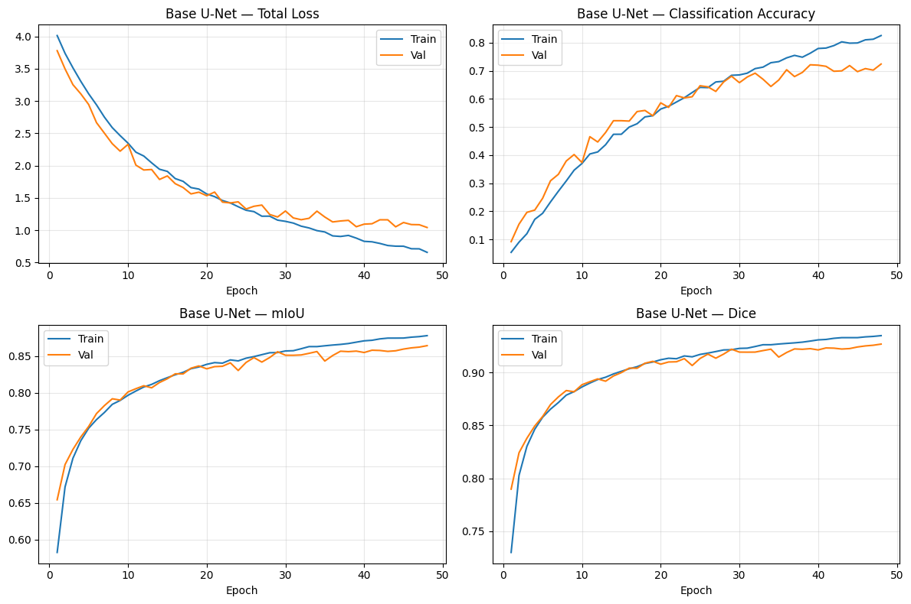
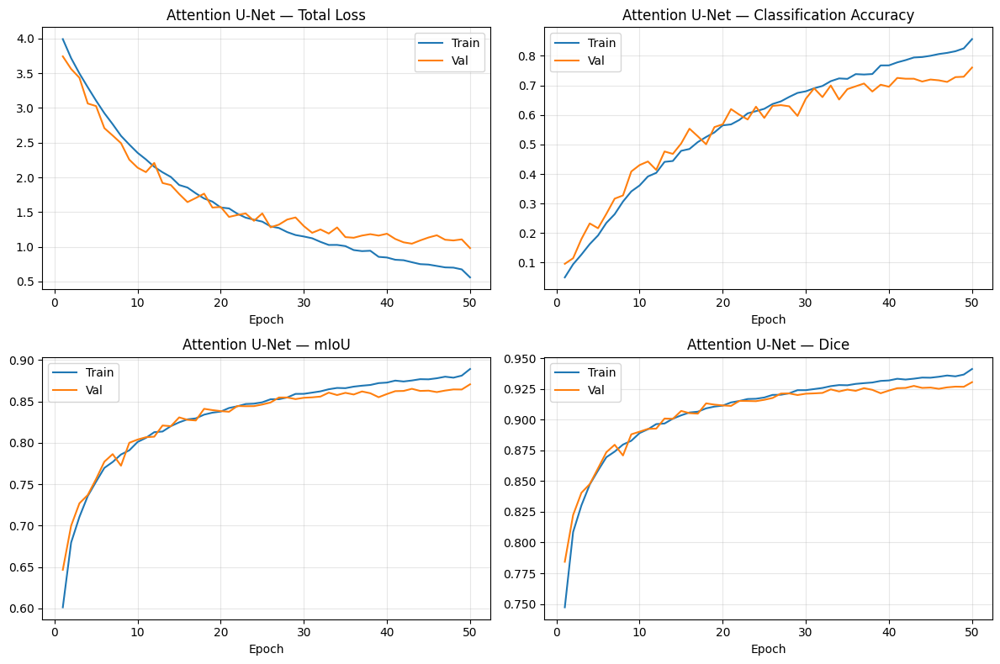
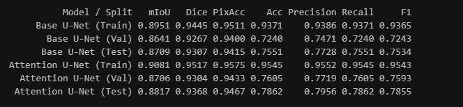
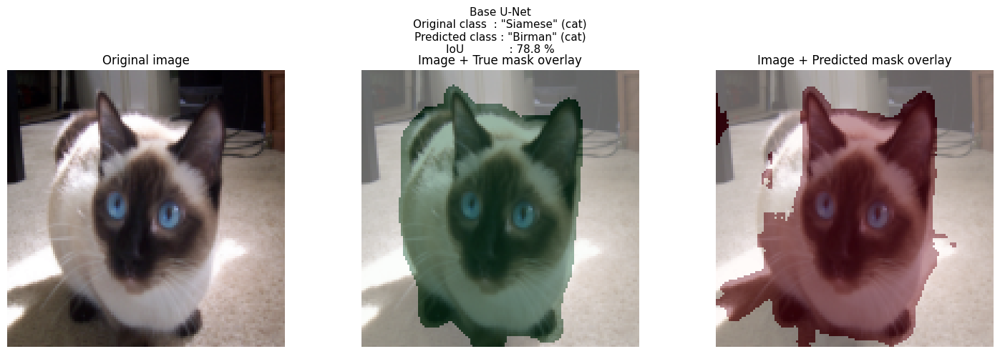
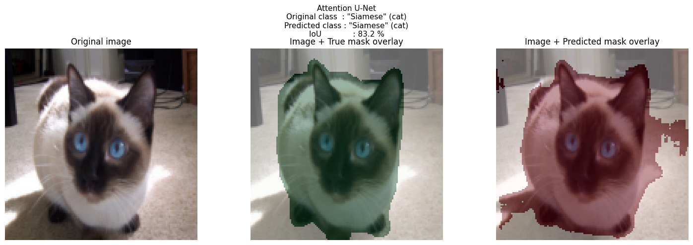
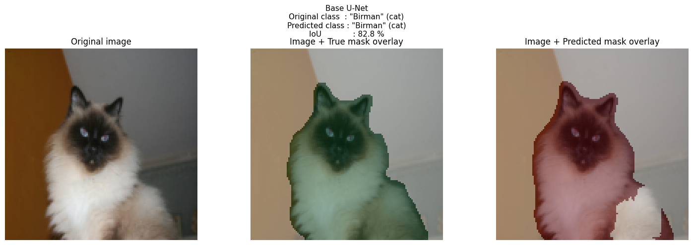
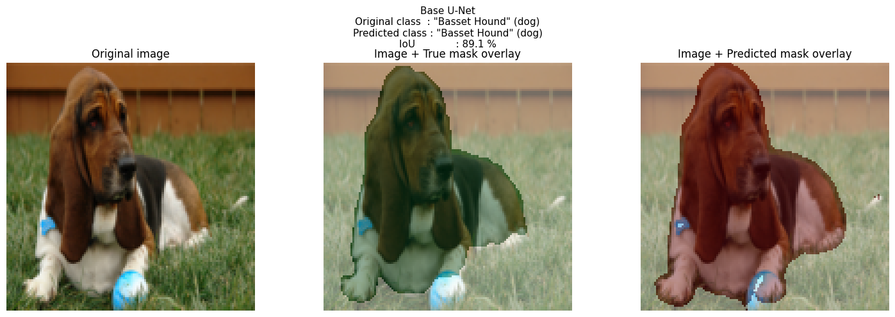

<a id="readme-top"></a>
# About The Project
This repository contains a PyTorch implementation for joint **binary pet segmentation** and **37-breed pet classification** using the Oxford-IIIT Pet Dataset. The project evaluates two end-to-end multi-task architectures—a standard **Base U-Net** and an **Attention U-Net**—both sharing an encoder-decoder backbone equipped with a bottleneck classification head. A **data augmentation ablation study** is also included to quantify the regularizing effect of augmentation. This project was developed as part of the CSE428 (Image Processing) course [project](https://github.com/azizulkabirjayed/13-pet-image-segmentation-and-classification-using-unet-and-attention-unet/blob/cdde9acd111d4d00a0f655e45fa2f67cc4312045/CSE428%20Spring%2026%20Project%20Guidelines%20(1).pdf) at BRAC University.
<p align="right">(<a href="#readme-top">back to top</a>)</p>

# Built With
* 
* 
* 
* 
* 
* 
* 
* 
* 
<p align="right">(<a href="#readme-top">back to top</a>)</p>

# Dataset & Preprocessing
* **Dataset:** [Oxford-IIIT Pet Dataset](https://www.robots.ox.ac.uk/~vgg/data/pets/) (37 breeds: 25 dogs, 12 cats).
* **Segmentation Mask Preprocessing:** The original 3-class trimap is converted into a binary mask:

  | Trimap Value | Meaning | Binary Mask |
  |:---:|:---|:---:|
  | 1 | Foreground (pet) | 1 |
  | 3 | Boundary | 1 |
  | 2 | Background | 0 |
* **Splits (Seed 42, Stratified):**
  * **Train (~80%)**
  * **Validation (~10%)**
  * **Test (~10%)**
* **Preprocessing & Augmentation:** Images and masks are resized to $128 \times 128$ (bilinear for images, nearest-neighbor for masks). Images are normalized with ImageNet mean/std. Augmentations (train only) include horizontal flip (p = 0.5), rotation ($\pm15^\circ$), and color jitter (brightness, contrast, saturation = 0.2) applied identically to image and mask for spatial transforms, and image-only for color jitter.
<p align="right">(<a href="#readme-top">back to top</a>)</p>


# Project Specifications

| Feature | Details |
| :--- | :--- |
| **Tasks** | Binary pet segmentation & 37-breed classification |
| **Models** | Base U-Net & Attention U-Net |
| **Input Dimensions** | $128 \times 128 \times 3$ |
| **Training Setup** | 50 Epochs (with Early Stopping, patience 10), Batch Size 16, Adam Optimizer |
| **Learning Rate** | $1\text{e-}4$ with ReduceLROnPlateau (mode=min, patience=5, factor=0.5), Weight Decay: $1\text{e-}5$ |
| **Loss Function** | `BCEWithLogitsLoss` (segmentation) + `CrossEntropyLoss` (classification), equal weight |
| **Dropout** | ConvBlock: 0.1, Bottleneck: 0.3, Classifier head: 0.5 |
| **Segmentation Threshold** | 0.5 |
| **Best Checkpoint** | Saved on best validation loss |
<p align="right">(<a href="#readme-top">back to top</a>)</p>


# Model Performance & Comparison

Metrics are evaluated using the best validation loss checkpoint saved during training. Classification metrics use **weighted** averaging.

| Model | Split | mIoU | Weighted Precision | Weighted Recall | Weighted F1 |
| :--- | :--- | :--- | :--- | :--- | :--- |
| **Base U-Net** | Train | 0.8698 | 0.8611 | 0.8591 | 0.8577 |
| | Validation | 0.8564 | 0.6469 | 0.6394 | 0.6315 |
| | **Test** | **0.8567** | **0.5897** | **0.5839** | **0.5782** |
| **Attention U-Net** | Train | 0.8618 | 0.8000 | 0.7970 | 0.7949 |
| | Validation | 0.8495 | 0.5909 | 0.5856 | 0.5746 |
| | **Test** | **0.8479** | **0.5410** | **0.5381** | **0.5338** |

### Test-Set Performance Difference (Attention U-Net − Base U-Net)
* **mIoU:** $-0.0089$
* **Dice Score:** $-0.0060$
* **Pixel Accuracy:** $-0.0037$
* **Breed Accuracy:** $-0.0461$
* **Weighted F1:** $-0.0443$
<p align="right">(<a href="#readme-top">back to top</a>)</p>


# How to Run
1. **Clone the Repository**
   ```bash
   git clone https://github.com/YOUR-USERNAME/cse428.git
   cd cse428
   ```

2. **Install Dependencies**
   ```bash
   pip install torch torchvision numpy pandas pillow tqdm matplotlib scikit-learn opencv-python-headless jupyter
   ```
   (A CUDA-enabled GPU is strongly recommended).

3. **Download Dataset**
   Download the images and annotations from the official [Oxford-IIIT Pet Dataset](https://www.robots.ox.ac.uk/~vgg/data/pets/) and extract them so that `images/` and `trimaps/` directories are in the same folder as the notebook.

4. **Run Notebook**
   ```bash
   jupyter notebook project_code.ipynb
   ```
<p align="right">(<a href="#readme-top">back to top</a>)</p>


# Contributors
* Sindid Arafat (sindid.arafat@g.bracu.ac.bd)
* Zarin Tasnim Promete (zarin.tasnim.promete@g.bracu.ac.bd)
<p align="right">(<a href="#readme-top">back to top</a>)</p>


# Sample Visualizations







<p align="right">(<a href="#readme-top">back to top</a>)</p>


